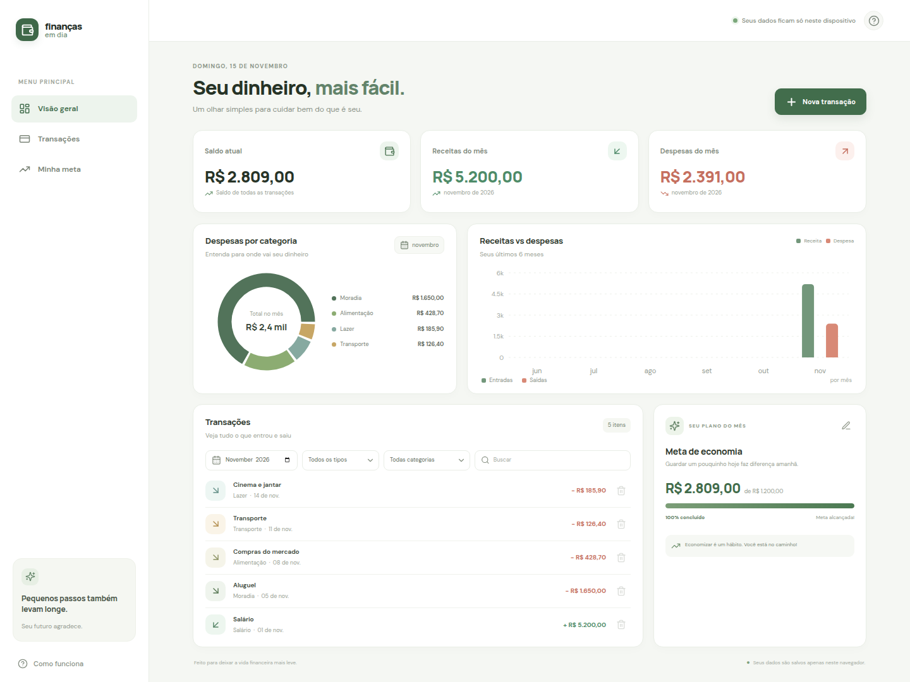

# Finanças em Dia

**Organização de finanças pessoais sem complicação.** Um app web leve para registrar receitas e despesas em segundos, visualizar para onde o dinheiro vai e acompanhar uma meta mensal — sem login e com dados guardados no próprio navegador.

> **Acesse o app:** [financas-em-dia-omega.vercel.app](https://financas-em-dia-omega.vercel.app)
>
> **Repositório público:** [ivan419419/financas-em-dia](https://github.com/ivan419419/financas-em-dia)

## Conceito

Finanças em Dia foi pensado para quem quer começar a cuidar do dinheiro, mas se sente desmotivado por ferramentas complexas. A interface concentra o essencial em uma tela clara: saldo atual, receitas e despesas do mês, movimentações recentes, distribuição dos gastos e progresso de economia.

## O que o app faz

- Mostra **Saldo atual**, **Receitas do mês** e **Despesas do mês**.
- Registra receitas ou despesas por meio do botão **Nova transação**, com descrição, valor em reais, categoria e data.
- Organiza as movimentações nas categorias Moradia, Alimentação, Transporte, Lazer, Saúde, Educação, Salário e Outros.
- Filtra por mês, tipo e categoria, permite buscar pela descrição e excluir itens.
- Apresenta um gráfico de rosca de despesas por categoria e um gráfico de barras de receitas versus despesas nos últimos seis meses.
- Acompanha uma meta de economia mensal editável, com barra de progresso.
- Inicia com cinco transações de demonstração quando não há dados salvos.
- Guarda transações e meta no `localStorage`; não exige conta e não envia dados financeiros para um servidor.

## Tecnologias

React 18 · TypeScript · Vite · Tailwind CSS · Recharts · Lucide React

## Rodar localmente

Requisitos: Node.js 20 ou superior e npm.

```bash
git clone https://github.com/ivan419419/financas-em-dia.git
cd financas-em-dia
npm install
npm run dev
```

Abra o endereço local informado pelo Vite (normalmente `http://localhost:5173`). Para validar uma compilação de produção:

```bash
npm run build
npm run preview
```

## PRD e prompt final

O documento completo do produto está em [`PRD.md`](./PRD.md). Este é o prompt final usado como briefing de construção:

> Crie um aplicativo web moderno chamado “Finanças em Dia”, em React + TypeScript + Tailwind CSS, para organização simples de finanças pessoais. O problema é que muitas pessoas não mantêm controle porque os apps são complicados; a solução deve permitir registrar receita ou despesa em poucos segundos e mostrar para onde o dinheiro vai. Faça um dashboard mobile-first e responsivo com três cards — Saldo Atual, Receitas do Mês e Despesas do Mês — e botão “+ Nova Transação” que abre um modal com descrição, valor em R$, tipo (Receita/Despesa), categoria (Moradia, Alimentação, Transporte, Lazer, Saúde, Educação, Salário, Outros) e data. Mostre uma lista de transações filtrável por mês, tipo e categoria, com ação para excluir. Inclua um gráfico de pizza/rosca de despesas por categoria, um gráfico de barras de receitas vs despesas e uma meta mensal de economia com barra de progresso editável. Persista os dados em localStorage, sem login, e inicialize com cinco transações de exemplo somente na primeira abertura. Use interface clara, limpa e acessível, cartões brancos arredondados, verde para receitas e vermelho/coral para despesas, textos em português do Brasil e valores em reais. Não use a imagem de referência como asset nem copie elementos proprietários; use-a apenas como inspiração visual. Inclua estados vazios, validação de formulário e instruções de execução local no README.

## Prévia do aplicativo



[Ver versão mobile](./docs/evidencias/dashboard-mobile.png) · [Ver formulário mobile](./docs/evidencias/nova-transacao-mobile.png)

As capturas acima são reais, geradas durante a execução do próprio app com dados de demonstração.

## Validação

Build de produção concluído com `npm run build`. Testes de ponta a ponta verificaram: cinco exemplos iniciais, gráfico de rosca, cadastro com vírgula decimal, persistência ao recarregar, filtros de tipo/categoria/mês, busca, exclusão, meta editável por mês, estado vazio, viewport móvel de 390 px sem rolagem horizontal e recuperação de dados locais inválidos. Nenhum erro de execução foi registrado nesses testes.

## Evidências do processo com IA

O briefing foi transformado em código com assistência de IA no Cue; o aplicativo não contém um agente financeiro de IA em execução. A atividade sugere anexar capturas reais de interações com Copilot ou Lovable. Nenhuma interação nessas plataformas foi realizada neste trabalho; por isso, **não foram inventadas nem incluídas capturas**. Se você fizer essas interações, adicione aqui as imagens ou vídeos originais antes de entregar, por exemplo em `docs/evidencias/`, com uma legenda para cada arquivo. A imagem de referência de design foi usada somente como inspiração visual, não como asset do app.

## Aprendizados e reflexão

Especificar o problema, o público, os campos do formulário e os critérios de aceite antes da implementação ajuda a transformar uma ideia ampla em entregas verificáveis. A simplicidade também depende de escolhas técnicas: neste MVP, o `localStorage` elimina cadastro e reduz a barreira inicial, mas significa que os dados permanecem apenas naquele navegador e não são sincronizados entre dispositivos. Os exemplos de dados e os estados vazios tornam o painel compreensível logo na primeira abertura. Um próximo passo seria testar a experiência com pessoas iniciantes e usar esse retorno para priorizar melhorias sem perder a proposta de poucos passos.

## Sobre o desafio DIO

Este repositório é um fork/adaptação do laboratório oficial [dio-lab-vibe-coding-app-financas](https://github.com/digitalinnovationone/dio-lab-vibe-coding-app-financas), usado como ponto de partida para a entrega da trilha Santander.
